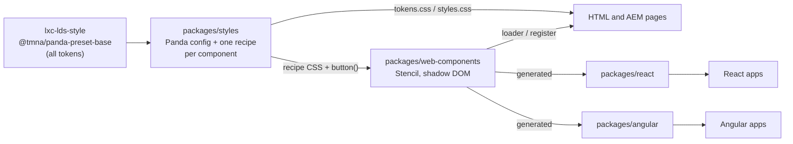

# LDS (Living Design System)

Toyota and Lexus design-system components. Each component is written once as a Stencil web component
and styled by a Panda CSS recipe built on the TMNA preset from the styling repo (lxc-lds-style).
React and Angular wrappers are generated from it, and everything is published to JFrog.

**Docs:** https://YOUR-ORG.github.io/YOUR-REPO/ (Storybook: every component plus the usage guides,
republished on each merge to `main`).

- [Packages](#packages)
- [How it fits together](#how-it-fits-together)
- [Using LDS in an app or page](#using-lds-in-an-app-or-page)
- [Repository layout](#repository-layout)
- [Prerequisites](#prerequisites)
- [Getting started](#getting-started)
- [Everyday commands](#everyday-commands)
- [Building a component](#building-a-component)
- [Styling rules](#styling-rules)
- [Testing](#testing)
- [Git workflow and CI](#git-workflow-and-ci)
- [Releasing](#releasing)
- [Dependencies and supply chain](#dependencies-and-supply-chain)
- [Troubleshooting](#troubleshooting)
- [Working with AI assistants](#working-with-ai-assistants)
- [One-time setup still to do](#one-time-setup-still-to-do)

## Packages

| Package                                 | What it is                                                                           |
| --------------------------------------- | ------------------------------------------------------------------------------------ |
| `@tmna-cx-design-system/styles`         | Tokens (from `@tmna/panda-preset-base`) + LDS recipes, as CSS and typed Panda output |
| `@tmna-cx-design-system/web-components` | The components (`<lds-button>` ...). Works in AEM HTL, plain HTML, React and Angular |
| `@tmna-cx-design-system/react`          | Generated React wrappers                                                             |
| `@tmna-cx-design-system/angular`        | Generated Angular standalone wrappers                                                |

All four share one version number and are released together.

## How it fits together



- **The styling repo owns the tokens** (colours, spacing, type, radii). LDS never defines its own.
- **LDS owns the recipes**: how each component uses those tokens, in `packages/styles/src/recipes/`.
- **Each component is written once** in `packages/web-components`. The React and Angular wrappers,
  JSX types and API docs are generated from it on every build.
- **Pages load the tokens once.** Components read the `--lds-*` variables from the page and carry
  their own recipe CSS inside their shadow DOM, so site CSS can't break them.

## Using LDS in an app or page

Every page or app loads the tokens once, then uses the components for its framework. The Storybook
"Guides" pages cover each setup in full, and `apps/` has a working example of each.

**HTML / AEM HTL** (see [apps/html-example](./apps/html-example) for a running page):

```html
<link rel="stylesheet" href="…/@tmna-cx-design-system/styles/dist/css/styles/tokens.css" />
<script type="module" src="…/@tmna-cx-design-system/web-components/dist/lds/lds.esm.js"></script>

<lds-button variant="secondary">Learn more</lds-button>
```

With a bundler, one import defines every component: `import '@tmna-cx-design-system/web-components/register';`.

Markup that can't be a web component can use the same recipe as classes, with `styles.css`
instead of `tokens.css`: `<button class="lds-button lds-button--variant_primary lds-button--size_md">`.
You get the look only; focus, keyboard and form behaviour are yours to handle.

**React**

```tsx
import '@tmna-cx-design-system/styles/tokens.css';
import { LdsButton } from '@tmna-cx-design-system/react';

<LdsButton variant="secondary" onClick={…}>Learn more</LdsButton>;
```

React 19 apps can also use `<lds-button>` directly, fully typed: import `…/web-components/register`
and `import type {} from '@tmna-cx-design-system/web-components/jsx'`.

**Angular**

```ts
// angular.json → "styles": ["node_modules/@tmna-cx-design-system/styles/dist/css/styles/tokens.css"]
import { LdsButton } from '@tmna-cx-design-system/angular';

@Component({ imports: [LdsButton], template: `<lds-button variant="secondary">Learn more</lds-button>` })
```

**React apps that use Panda themselves** can build on LDS directly: `designSystem: '@tmna-cx-design-system/styles'`
in their `panda.config.ts` gives them the same tokens and recipes (`import { button } from 'styled-system/recipes'`).

**Browser support:** Chrome and Edge 99+, Firefox 97+, Safari 16.4+ (macOS and iOS). No IE and no ES5 build.

## Repository layout

```text
.
├── packages/
│   ├── styles/            Panda config, recipes (src/recipes/), the token-checked defineRecipe wrapper
│   ├── web-components/    Stencil components (src/components/lds-*), register/, JSX types script
│   ├── react/             Generated React wrappers (src/generated/) + a wrapper test
│   └── angular/           Generated Angular wrappers (src/generated/), built with ng-packagr
├── apps/
│   ├── storybook/         Component docs, story tests, usage guides (docs/*.mdx)
│   ├── html-example/      Plain HTML consumer          :4300
│   ├── react-example/     React 19 consumer            :4301
│   └── angular-example/   Angular consumer             :4302
├── tools/
│   ├── generators/        nx g @lds/generators:component
│   ├── smoke-test/        lds-smoke: checks an example's production build in Chromium
│   └── scripts/           pack-local.mjs (pnpm pack:local)
├── vendor/                TMNA preset tarball, until it is published to JFrog
├── .github/               CI, release and docs workflows; CODEOWNERS; AI instructions, skills, prompts
├── .nx/version-plans/     Release notes waiting for the next release
├── AGENTS.md              Rules for contributors and AI agents
└── pnpm-workspace.yaml    Workspace packages, version catalog, supply-chain settings
```

Generated files are never edited by hand: `*/src/generated/**`, `packages/web-components/src/components.d.ts`,
component `readme.md` below "Auto Generated Below", and `dist/`, `loader/`, `components/`, `styled-system/`.

## Prerequisites

| Tool     | Version                     | How                                                                   |
| -------- | --------------------------- | --------------------------------------------------------------------- |
| Node.js  | 24 (from `.nvmrc`)          | `fnm use` or `nvm use`. The Angular example needs 22.22.3+ or 24      |
| pnpm     | 12.11 (from `package.json`) | `corepack enable` picks the right version. Never use npm or yarn here |
| Chromium | Playwright's build          | `pnpm exec playwright install chromium` (for tests)                   |
| JFrog    | A personal npm token        | Only to install or publish `@tmna*` packages from JFrog, see below    |

The repo's `.npmrc` only routes the `@tmna-cx-design-system`, `@tmna-cx-ds-organisms` and `@tmna` scopes to
JFrog. Tokens never go in the repo. Put yours in your user config once:

```bash
pnpm config set "//YOUR-COMPANY.jfrog.io/artifactory/api/npm/lds-npm/:_authToken" "<your token>"
```

## Getting started

```bash
git clone https://github.com/sriramj-ps/tmna-lds-components.git && cd tmna-lds-components
fnm use                      # Node 24 (see .nvmrc)
corepack enable              # pnpm version from package.json
pnpm install                 # also installs the git hooks
pnpm exec playwright install chromium
pnpm nx run-many -t build    # styles -> web components -> React/Angular wrappers
pnpm nx storybook storybook  # http://localhost:6006
pnpm nx serve html-example   # http://localhost:4300 (also react-example :4301, angular-example :4302)
```

## Everyday commands

```bash
pnpm nx g @lds/generators:component <name>          # new component + its recipe (no lds- prefix)
pnpm nx build web-components                        # builds styles first; regenerates React/Angular wrappers
pnpm nx dev web-components                          # Stencil watch mode
pnpm nx storybook storybook                         # docs + stories at http://localhost:6006
pnpm nx affected -t lint stylelint typecheck test build publint   # what CI checks, for what you changed
pnpm nx test web-components -- -u                   # accept intended visual changes
pnpm nx format:write                                # format everything
pnpm nx release plan <patch|minor|major> -m "..."   # record a change for the next release
pnpm pack:local                                     # try your LDS build in another app (see Guides/Test locally)
pnpm nx graph                                       # see how the packages depend on each other
pnpm nx reset                                       # clear the Nx cache if a build looks stale
```

## Building a component

1. **Agree the API with design first**: props (name, type, default), events, slots and CSS parts.
2. **Scaffold** with `pnpm nx g @lds/generators:component card --description="…"`. This creates
   `packages/web-components/src/components/lds-card/` (component, CSS, stories, visual test) and
   `packages/styles/src/recipes/card.ts`, and registers the recipe.
3. **Style it in the recipe only**, using preset tokens (see Styling rules).
4. **Write the component** (`lds-card.tsx`): markup, props, events, keyboard and accessibility.
   `lds-button` is the reference implementation.
5. **Add stories** with `play()` tests for behaviour, and put every variant in the visual test.
6. **Build**: `pnpm nx build web-components`. The React and Angular wrappers, JSX types, `register`
   and API docs update automatically.
7. **Check**: `pnpm nx affected -t lint stylelint typecheck test build publint`.
8. **Record the change**: `pnpm nx release plan minor -m "Add lds-card"`, then open a PR.

Form controls (input, checkbox, select) also need an entry in `valueAccessorConfigs` in
`packages/web-components/stencil.config.ts`, so they work with Angular forms.

## Styling rules

- **Tokens only.** Recipes use token names (`paddingInline: '4'`, `color: 'black'`), and Panda turns them
  into `var(--lds-…)`. A raw value like `'13px'` fails `nx typecheck styles`.
- **Always import `defineRecipe` from `../define-recipe`**, never from `@pandacss/dev`. The wrapper is
  what checks the values.
- **Long property names**: `backgroundColor`, not `bg`.
- **Need a value that has no token?** Ask the styling repo (lxc-lds-style) to add it, then update the
  preset (`lds-update-preset` skill). Never add tokens here.
- **Class names are public API.** HTML-only pages use `lds-<recipe>--<variant>_<value>`, so renaming a
  recipe or variant is a breaking change.
- A component's `.css` file only imports its recipe CSS and sets `:host` layout.

## Testing

| What                                             | Where                                          | Run                                            |
| ------------------------------------------------ | ---------------------------------------------- | ---------------------------------------------- |
| Stories: `play()` and axe a11y (violations fail) | `*.stories.ts` next to each component          | `pnpm nx test storybook`                       |
| Visual screenshots                               | `*.visual.test.ts` next to each component      | `pnpm nx test web-components`                  |
| `register` defines every tag                     | `packages/web-components/src/register.test.ts` | `pnpm nx test web-components`                  |
| React wrappers                                   | `packages/react/src/*.test.tsx`                | `pnpm nx test react`                           |
| Example apps, production build in Chromium       | `apps/*-example` (`lds-smoke`)                 | `pnpm nx test react-example` (etc.)            |
| Lint, Stylelint, types                           | every project                                  | `pnpm nx run-many -t lint stylelint typecheck` |

**Visual screenshots.** Each test compares against a reference image per platform, in the
component's `__screenshots__/` folder: `*-chromium-linux.png` is what CI checks, and
`*-chromium-darwin.png` is the macOS reference for local runs. When a change to the look is intended,
run `pnpm nx test web-components -- -u` and commit the updated image. If CI's visual test fails, the
run's `visual-diffs` artifact shows the new and expected images.

## Git workflow and CI

- **Branch from `main`** and open a pull request. CODEOWNERS adds the right reviewers.
- **Commit messages follow Conventional Commits**: `type(scope): what changed`, e.g.
  `feat(button): add size prop`. The scope is the package or component name, in kebab-case.
- **Git hooks** ([lefthook.yml](./lefthook.yml), installed by `pnpm install`) run on your machine:

  | When           | What runs                                                                                      |
  | -------------- | ---------------------------------------------------------------------------------------------- |
  | Commit         | Prettier, ESLint and Stylelint fix the staged files; anything unfixable blocks the commit      |
  | Commit message | commitlint checks the Conventional Commits format                                              |
  | Push           | lint, typecheck and test for the projects your branch affects (all projects on the first push) |

  Skip them only in an emergency: `LEFTHOOK=0 git commit …`. CI runs everything anyway.

- **CI** ([ci.yml](./.github/workflows/ci.yml)) runs on every PR in the Playwright Docker image:
  formatting; lint, Stylelint, typecheck, build, test and publint for affected projects; a check that
  generated files are committed and up to date; and a check that changed packages have a version plan.

## Releasing

1. **Every releasable change adds a version plan**: `pnpm nx release plan <patch|minor|major> -m "…"`.
   It is a small file in `.nx/version-plans/`; CI fails a PR that changes a package without one.
   Breaking changes (a removed or renamed prop, event, slot, part, recipe or variant) are `major`.
2. **Release from GitHub Actions**: Actions > Release > Run workflow. It runs in the protected
   `release` environment, so a reviewer approves it.

| Input     | Options            | What happens                                                                                |
| --------- | ------------------ | ------------------------------------------------------------------------------------------- |
| `channel` | `latest`           | Versions from the plans, `CHANGELOG.md`, git tag `vX.Y.Z`, GitHub release, publish to JFrog |
|           | `next`             | Prerelease `X.Y.Z-next.N` under the `next` tag. No commit or tag; plans are kept            |
| `dry-run` | on (default) / off | On: shows what would happen and writes nothing. Run it first                                |

Teams can try a prerelease with `pnpm add @tmna-cx-design-system/react@next`.

## Dependencies and supply chain

- **One version per dependency**, in the catalog in `pnpm-workspace.yaml`. Packages write `"catalog:"`
  instead of a version. To add a dependency, add it to the catalog first.
- **Install scripts are off by default.** Only packages listed in `allowBuilds` may run them, and an
  install fails if a new one asks. Add it as `true` only if it really needs the script.
- **New versions wait a day** (`minimumReleaseAge`) before pnpm installs them, except our own scopes.
  A version whose publish trust level dropped is refused (`trustPolicy`).
- **Renovate** ([renovate.json](./renovate.json)) opens grouped update PRs (Storybook, Angular, Stencil,
  Vitest, lint tools, Panda). Panda and the TMNA preset move together, pinned. Nx is upgraded with
  `pnpm nx migrate latest` instead.

## Troubleshooting

| Problem                                                  | Fix                                                                                                       |
| -------------------------------------------------------- | --------------------------------------------------------------------------------------------------------- |
| Components render without colours or spacing             | The page isn't loading `tokens.css` (or `styles.css`)                                                     |
| A recipe change doesn't show in Storybook                | Storybook doesn't watch recipes. Run `pnpm nx build web-components` and refresh                           |
| `ERR_PNPM_IGNORED_BUILDS` on install                     | A new dependency wants an install script. Add it to `allowBuilds` (`false` if it ships prebuilt binaries) |
| `404` for `@tmna/…` or `@tmna-cx-design-system/…`        | JFrog token missing or expired (see Prerequisites), or the package isn't published yet                    |
| Angular CLI: "requires a minimum Node.js version"        | Switch to Node 24: `fnm use`                                                                              |
| Visual test fails with a new `*-chromium-<platform>.png` | No reference exists for your platform yet. Commit it only if the team agrees it's correct                 |
| `nx affected` complains about `origin/main`              | `git fetch origin main`                                                                                   |
| A build looks stale or a target behaves oddly            | `pnpm nx reset`, then build again                                                                         |

## Working with AI assistants

- [AGENTS.md](./AGENTS.md) holds the rules every assistant and contributor follows: packages, hard
  rules, commands, definition of done.
- `.github/copilot-instructions.md` and `.github/instructions/` add rules for components, tests and styles.
- `.github/skills/` has step-by-step skills: `lds-new-component` and `lds-update-preset`.
- `.github/prompts/` has shared prompts (`lds-new-component`, `lds-update-preset`, `lds-review`) that
  both Copilot and Slingshot can use.
- `.github/agents/lds-reviewer.agent.md` reviews a change against the rules without editing it.

## One-time setup still to do

1. Replace `YOUR-COMPANY` / `lds-npm` with your JFrog host and repository in `.npmrc` and `.github/workflows/release.yml`,
   and add the `JFROG_NPM_TOKEN` secret.
2. Replace `YOUR-ORG` team names in `.github/CODEOWNERS`.
3. Turn on the docs site: Settings > Pages > Source = "GitHub Actions" (or swap the host in
   `.github/workflows/docs.yml`), then put its URL at the top of this file.
4. Install Renovate on the repo (or confirm the org's self-hosted Renovate) and give it read access to JFrog.
5. When the styling repo publishes `@tmna/panda-preset-base` to JFrog, replace the `file:../../vendor/…tgz`
   version in `packages/styles/package.json` with the published version and delete `vendor/`.
